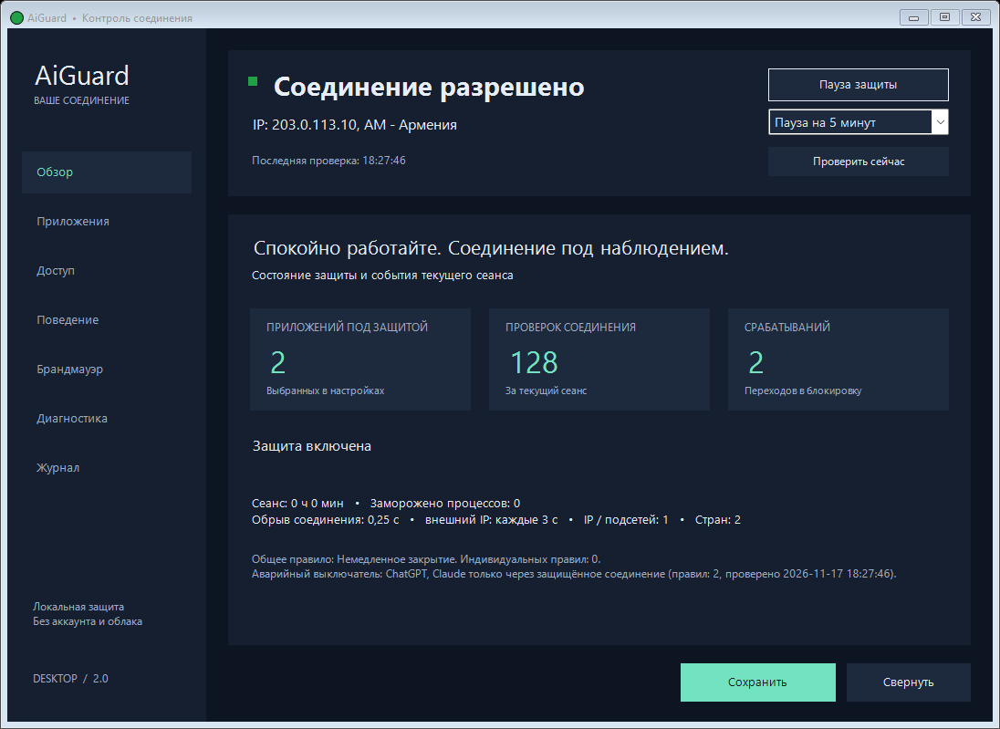
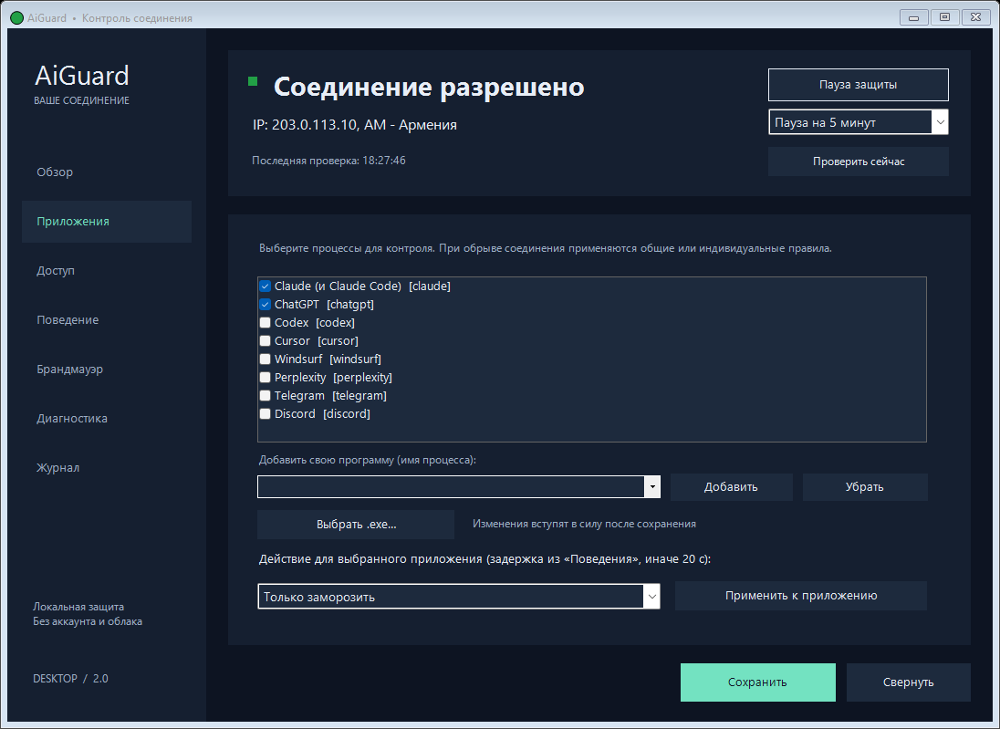
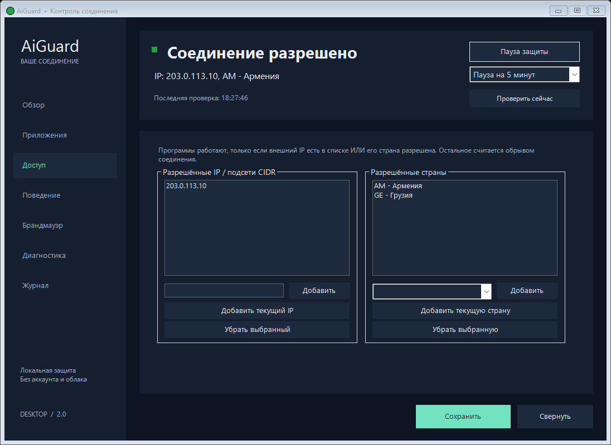
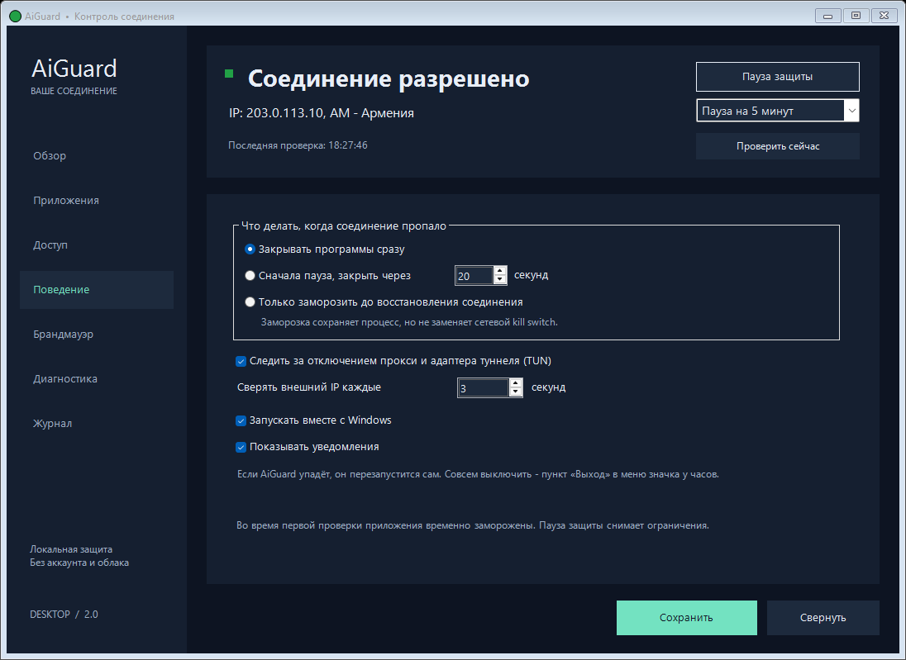
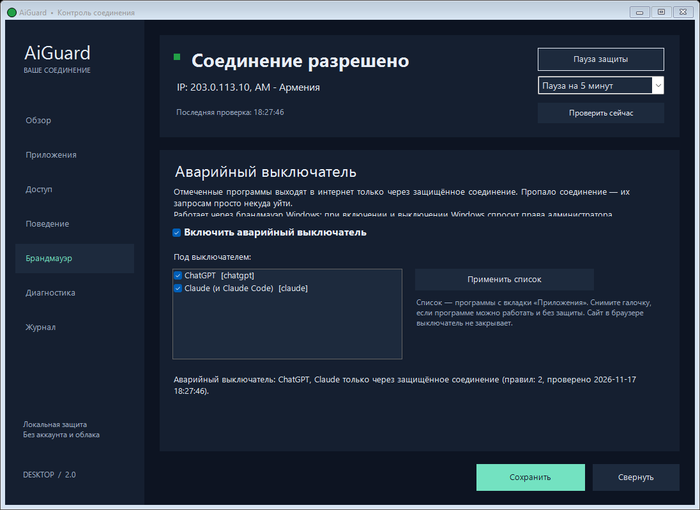

# AiGuard для Windows

Бесплатная портативная утилита, которая защищает Claude, ChatGPT и другие выбранные программы при обрыве защищённого соединения. AiGuard следит за внешним IP и страной, мгновенно замораживает отмеченные программы при обрыве и может закрыть им выход в интернет через брандмауэр Windows.

- [Скачать ZIP на странице релиза](../../releases/latest)
- [Инструкция по запуску и настройке](Инструкция.md)

## Три уровня защиты

| Уровень | Что делает |
| --- | --- |
| 1. Дозор | Каждые 3 секунды сверяет внешний IP и страну со списком разрешённых. Проверяет, каким адресом вас видят сами Claude и ChatGPT, ищет утечки DNS и IPv6. |
| 2. Заморозка | Пропал адаптер туннеля или прокси — за 0,25 секунды отмеченные программы замирают (или закрываются, как вы настроили). Соединение вернулось — продолжают работу с того же места. |
| 3. Стена (аварийный выключатель) | Правило брандмауэра Windows: отмеченные программы выходят в интернет только через защищённое соединение. Пропало соединение — их запросам некуда уйти. Включается переключателем на вкладке «Брандмауэр». |

Ещё: правила по IP, подсети и стране, отдельное действие для каждого приложения, пауза защиты, автозапуск, журнал, экспорт диагностики, повторная проверка после сна и смены сети, самовосстановление после сбоя. Всё работает локально, без аккаунта и облака. Все функции бесплатны.

## Как это выглядит

| Приложения | Доступ |
| --- | --- |
|  |  |
| **Поведение** | **Брандмауэр** |
|  |  |

Адреса на снимках вымышленные.

## Ограничения

- Никакая программа не даёт полной гарантии. Если сервис уже попросил подтвердить личность, AiGuard не поможет.
- Сайт в браузере аварийный выключатель не закрывает: он работает для программ (Claude, ChatGPT, Codex и др.).
- Если брандмауэр Windows выключен или его заменяет сторонний, стена не действует — окно AiGuard предупредит.
- Нужны Windows 10/11, Windows PowerShell 5.1 и Windows Script Host. Для включения стены — права администратора (Windows спросит один раз).
