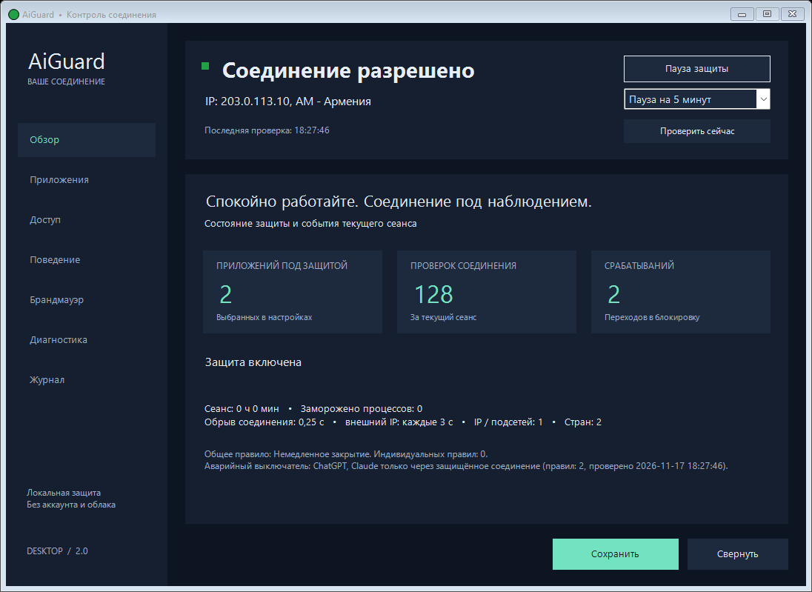
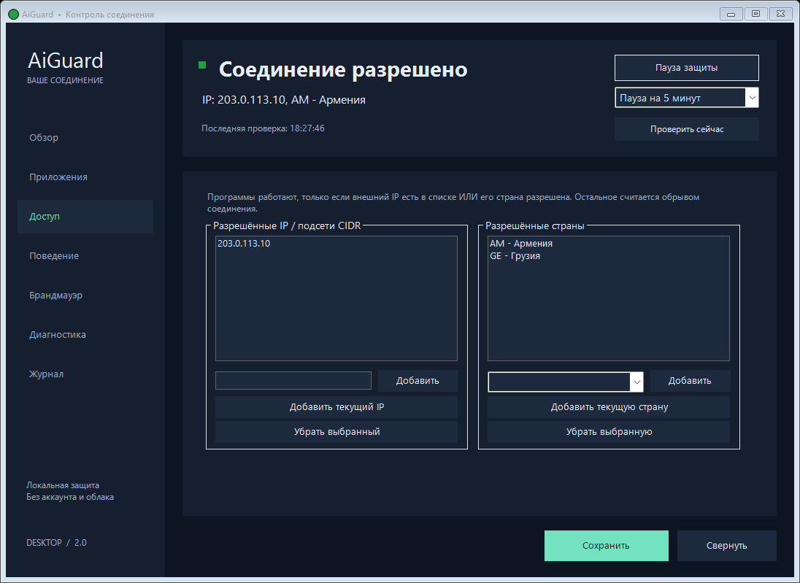
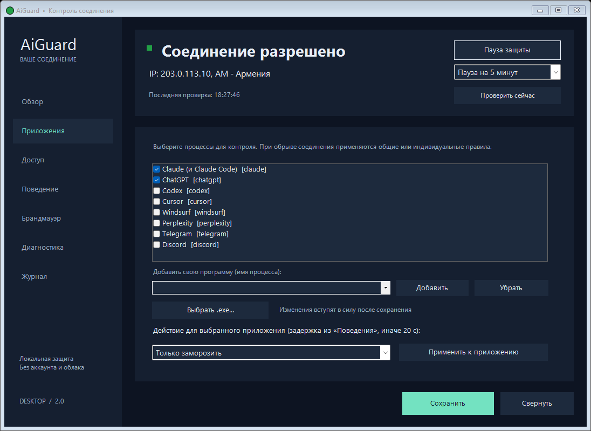
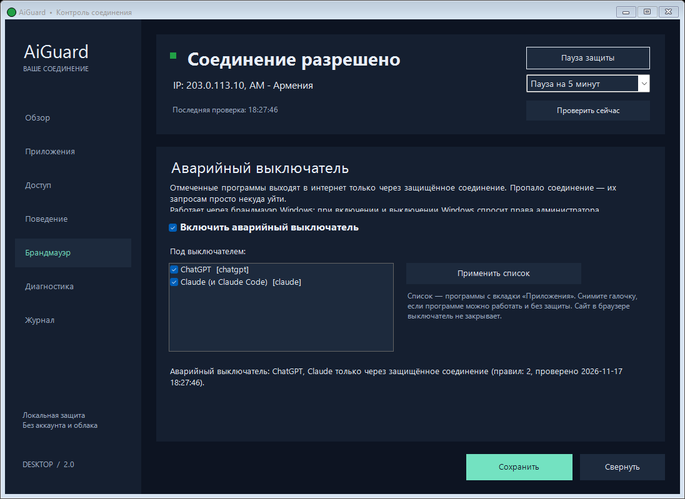
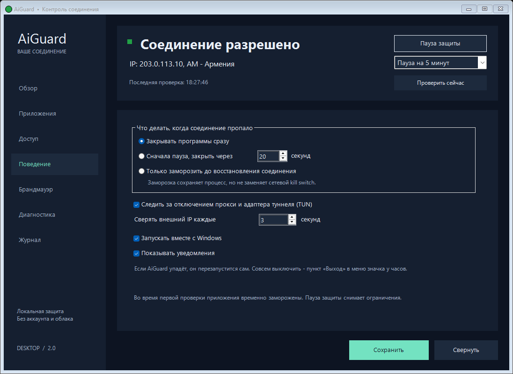

# Как пользоваться AiGuard

## 1. Скачать и запустить

1. Откройте [страницу релиза](../../releases/latest) и скачайте `AiGuard-v0.2.0.zip` в разделе **Assets**.
2. Нажмите правой кнопкой по ZIP → **Извлечь всё**. Выберите постоянную папку с правом записи, например `Документы\AiGuard`.
3. Дважды щёлкните **Запуск AiGuard.vbs**. Откроется окно, а рядом с часами появится значок AiGuard.
4. Включите своё защищённое соединение и подождите, пока на вкладке **Обзор** появится ваш внешний IP.

## 2. Вкладка «Доступ» — разрешить своё соединение

1. Пока защищённое соединение включено, нажмите **Добавить текущий IP**. Если адрес меняется, добавьте страну: **Добавить текущую страну**.
2. Совпадение с любым разрешённым IP **или** страной считается достаточным.
3. Нажмите **Сохранить**, затем **Проверить сейчас**. В «Обзоре» появится **Соединение разрешено**.

## 3. Вкладка «Приложения» — что защищать

1. Отметьте галочками Claude, ChatGPT или нажмите **Выбрать .exe…**, чтобы добавить свою программу.
2. Для каждой программы можно выбрать действие: **Только заморозить**, **Заморозить, затем закрыть** или **Закрыть сразу**.
3. Нажмите **Сохранить**.

## 4. Вкладка «Брандмауэр» — аварийный выключатель

1. После первого сохранения программ AiGuard сам предложит включить аварийный выключатель. Его можно включить и вручную: переключатель **Включить аварийный выключатель**.
2. AiGuard переспросит «Вы точно уверены?», затем Windows попросит права администратора.
3. Готово: отмеченные программы выходят в интернет только через защищённое соединение. Снимите галочку в списке, если какой-то программе можно работать без защиты, и нажмите **Применить список**.
4. Правила обновляются сами — после обновления программ, при подключении к новой сети и каждые 15 минут.
5. Проверка: выключите защищённое соединение — защищённая программа перестанет открывать страницы. Включите — снова работает.

Запасные ярлыки без окна: **Включить kill switch.cmd**, **Проверить kill switch.cmd**, **Выключить kill switch.cmd**.

## 5. Поведение, автозапуск, пауза, выход

- **Поведение** — что делать при обрыве: закрыть сразу, пауза и закрыть через N секунд или только заморозить.
- **Поведение → Запускать вместе с Windows → Сохранить** — AiGuard стартует в фоне при входе.
- **Пауза защиты** временно снимает ограничения (5, 15, 30 минут или без таймера).
- Двойной щелчок по значку у часов открывает окно. Крестик и **Свернуть** оставляют защиту работать. Полный выход — правая кнопка по значку → **Выход**.

## Удаление

1. Вкладка **Брандмауэр** → выключите аварийный выключатель (или **Выключить kill switch.cmd**).
2. Снимите автозапуск, сохраните, выберите **Выход** у значка и удалите папку.

## Если что-то не работает

- **Нет разрешённого соединения.** Откройте **Диагностику**, нажмите **Обновить** и сравните IP, который видят сервисы, с правилами в **Доступе**.
- **Аварийный выключатель не включается.** Причина видна под переключателем; подробности — в `firewall.log` в папке программы.
- **Не открывается окно.** Проверьте значок в области уведомлений (в том числе скрытые значки) и что архив распакован целиком.
- Перед отправкой отчёта об ошибке проверьте его: там могут быть ваши IP и названия программ.
